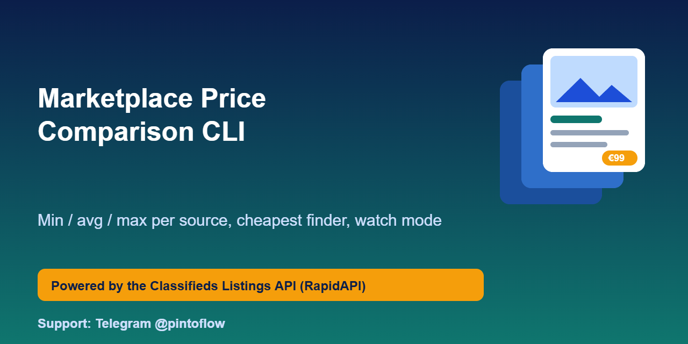
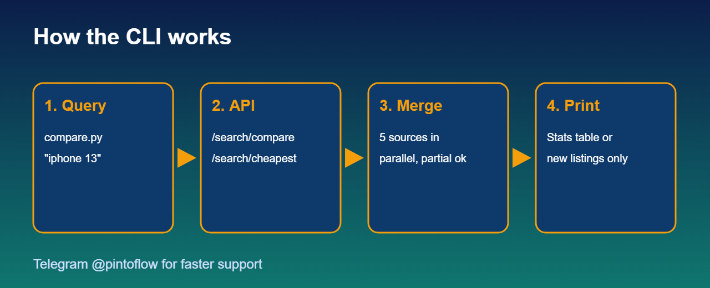

<p align="center"></p>

# Marketplace Price Comparison CLI

Compare second-hand prices across OLX, Wallapop, Leboncoin, Custojusto and Facebook Marketplace from your terminal, or watch a search and print only **new** listings. Built on the [Classifieds Listings API](https://rapidapi.com/belchiorarkad-FqvHs2EDOtP/api/classifieds-listings-api).

> ⚡ Support and feature requests: Telegram **[@pintoflow](https://t.me/pintoflow)**



## Install

```bash
git clone https://github.com/BelNaruto/marketplace-price-comparison-cli
cd marketplace-price-comparison-cli
pip install -r requirements.txt
export RAPIDAPI_KEY=...            # see .env.example
```

## Usage

```bash
python compare.py "iphone 13" --sources olx,wallapop --max-price 400   # min/avg/max per source
python compare.py "sofa" --cheapest --limit 10                          # cheapest listings with links
python compare.py "ps5" --watch 300                                     # check every 5 min, print only new ones
```

Example output:

```
source       count       min       avg       max
wallapop        20     85 EUR    380 EUR   900 EUR
olx             20    100 EUR    412 EUR  1,200 EUR
ALL             40     85 EUR    396 EUR  1,200 EUR
```

## How it works

`compare.py` calls `/api/search/compare` (per-source statistics) or `/api/search/cheapest` (price-sorted merged list). If one source fails the API still returns the others with an `errors` array, and the CLI prints a partial-result note.

## Ideas to extend

- Export results to CSV and chart price history over time
- Send a desktop or email notification from `--watch`
- Compare the same item across countries to spot resale arbitrage

## Get an API key

Subscribe to the API (free plan available): https://rapidapi.com/belchiorarkad-FqvHs2EDOtP/api/classifieds-listings-api

## Disclaimer

Unofficial; not affiliated with Meta, OLX, Wallapop, Leboncoin or Custojusto. Prices and availability come from the marketplaces and can change at any time.

---
> 💬 Telegram **[@pintoflow](https://t.me/pintoflow)**
